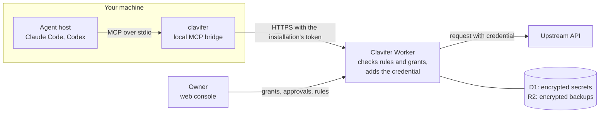

# Clavifer

[中文](README.zh-CN.md)

Clavifer is a self-hosted credential service for AI agents. An agent calls an upstream API through Clavifer, the service adds the credential on the server side, and one administrator, the Owner, decides in a web console what each agent may do.

It runs on Cloudflare Workers with D1 and R2. It has three parts: the Worker, the console, and `clavifer`, a command line client that connects agent hosts such as Claude Code and Codex to the service over MCP.

## How it works

An agent that holds an API key can leak it into its context, its logs or a file. Clavifer keeps the key away from the agent. The Owner stores it as a secret and defines a connection: a fixed upstream origin, the way the credential is added to a request, and the paths and methods that are allowed. The agent names a connection and a path; it never handles the key.



1. The agent calls the MCP tool `http.request` with a connection, a method and a path.
2. `clavifer` adds the access token of its installation, taken from the credential store of the operating system, and forwards the call.
3. The Worker checks that the installation is not revoked, and checks the request against the connection's rules and the installation's grants.
4. If the request is allowed, the Worker decrypts the secret, adds the credential to the request, and sends it to the connection's origin. The agent receives the upstream response.
5. If it is not allowed, the agent receives an error code with a hint. Unless a deny rule matched, the agent can submit an access request, and the Owner approves or denies it in the console.

A second mode exists for programs that need the value itself: `clavifer run` starts a program with secret fields in its environment. This needs a separate grant, and the program can read the value.

## Features

Everything listed here is implemented.

- A connection has a fixed origin, one of five ways to add the credential (none, bearer token, header, basic authentication, query parameter), allowed paths and methods, and three kinds of rules: deny, approval required, and free of approval.
- Each agent client is an installation that the Owner creates. Grants are given per installation and per resource, expire, and can be revoked. A grant to read a secret can be limited to some of its fields.
- An agent can submit an access request: for a grant, for a temporary scope extension beyond a connection's allowed paths and methods, or for a one-time approval of one exact request. A one-time approval is valid for 10 minutes and runs once.
- An agent can submit a draft: a new secret with its connections, or a change to a connection, together with test cases. The service runs the tests against its real decision logic when the draft is submitted. The Owner enters the credential value when approving.
- A connection can list extra hosts, or allow any host. Sending the credential to one of them always takes a one-time approval that is bound to that address.
- The MCP server has four tools: `credentials.list`, `access.request`, `access.status` and `http.request`. No tool returns a stored credential.
- The command line client keeps login tokens in the operating system's credential store and refreshes them automatically. Named profiles keep several installations apart. `status --wait` blocks until the Owner decides, so an agent continues on its own after an approval. `doctor` checks the setup without reading secrets.
- The Owner signs in with a password or a Passkey. New grants, approvals, connection changes and backup operations need a sign-in from the last 10 minutes.
- Each secret version is encrypted with its own key, which is wrapped by a key held in a Worker secret. Replacing a value creates a new version.
- Automatic backups, encrypted to an age public key, are written to R2 with daily and monthly retention. The Owner can export manually and restore into an empty deployment.
- Each audit log entry carries the request ID that the response returned in `x-request-id`.

## Status and limits

Clavifer is version 0.5.0. Its author runs it for personal use. It has not had an independent security audit.

- It deploys to Cloudflare only. The author has run and verified it on the Workers Paid plan. The Workers Free plan allows 10 ms of CPU time per request, which is probably too little for password hashing and encryption; this is untested.
- There is one Owner. There are no further users or roles, and no account recovery by email.
- The console is in Chinese only. The documentation quotes its labels with an English explanation.
- The command line client is built for Windows first and verified there with Claude Code and Codex. It compiles for macOS and Linux but has not been run on a real machine of either, and it has no install script for them.
- Some upstream services refuse requests that come from Cloudflare Workers, by egress address or by the `Cf-Ray` header. Such an upstream cannot be connected unless you run your own relay.
- The service returns upstream responses unchanged. It does not detect an upstream that echoes the credential, so connect only upstreams you trust.
- There is no procedure for rotating the server's own keys.

[docs/security-model.md](docs/security-model.md) describes what is and is not protected.

## Quick start

A local instance needs Node.js 22.12 or later and no Cloudflare account.

```
npm ci
npm run build:web
node scripts/init-secrets.mjs
npm run db:local
npm run dev
```

Open `http://localhost:8787`, and create the Owner with the token in `work/local-bootstrap.token`. Open that file yourself; do not paste it into an agent conversation. [Part A of docs/deploy.md](docs/deploy.md#part-a-local-trial) gives the same steps with a check after each one.

## Deploying

The deployment document is written for a coding agent to execute: every step says whether the agent or you perform it, gives the exact command, and says how to check the result. The agent never reads the server secrets; it generates them into files that you move to your password manager.

Clone the repository, open it in your coding agent, and say:

> Deploy this project to my Cloudflare account by following docs/deploy.md. Stop and ask me at every step marked Human.

To deploy by hand, follow [docs/deploy.md](docs/deploy.md) yourself and perform the Agent steps too.

## Documentation

Getting started:

- [docs/deploy.md](docs/deploy.md): local trial, production deployment, upgrading, backup and restore
- [docs/clients.md](docs/clients.md): connecting Claude Code or Codex, and the command line client

Concepts and reference:

- [docs/connections.md](docs/connections.md): connections, rules, grants and access requests
- [docs/authentication.md](docs/authentication.md): Owner sign-in and OAuth for clients
- [docs/security-model.md](docs/security-model.md): what the service protects and where the boundaries are
- [docs/api.md](docs/api.md): the HTTP API

Project:

- [SECURITY.md](SECURITY.md): reporting a vulnerability
- [CONTRIBUTING.md](CONTRIBUTING.md): development setup and checks
- [CHANGELOG.md](CHANGELOG.md): changes by version

## License

[Apache-2.0](LICENSE). Copyright 2026 Oganneson; see [NOTICE](NOTICE).
