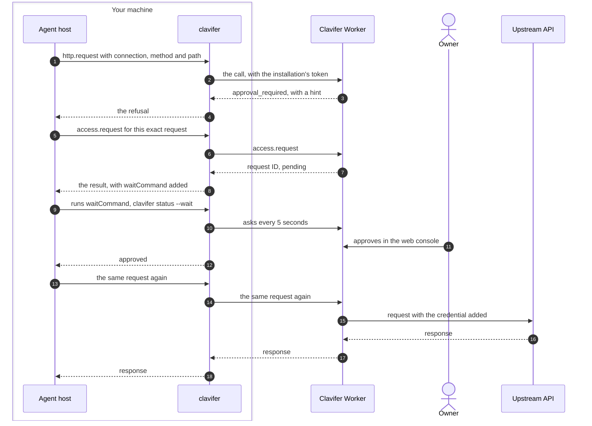

<p align="center"><picture>
  <source media="(prefers-color-scheme: dark)" srcset="docs/assets/logo-dark.svg">
  
</picture></p>

<p align="center"><strong>AI agents call APIs through Clavifer. The credential stays on the server.</strong></p>

<p align="center">
  <a href="#documentation">Docs</a> · <a href="docs/deploy.md">Deploy</a> · <a href="docs/clients.md">Connect an agent</a> · <a href="docs/security-model.md">Security model</a> · <a href="README.zh-CN.md">简体中文</a><br>
  <a href="https://github.com/Ogannesson/clavifer/actions/workflows/ci.yml"></a>
  <a href="LICENSE"></a>
</p>

Clavifer is a self-hosted credential service for AI agents that call APIs needing a key. The agent sends its request through Clavifer and the server adds the credential, so the agent never holds it. One administrator, the Owner, decides in a web console what each agent may do. Clavifer runs on your own Cloudflare account with Workers, D1 and R2. Its command line client, `clavifer`, connects an agent host (the program that runs the agent, such as Claude Code or Codex) to the service over MCP.

What the agent sees when a request needs the Owner's approval (illustrative; IDs, hints and fields are shortened):

```text
> http.request    POST /v1/payments/1 on connection CONNECTION_ID
< error           approval_required: "needs a one-time Owner approval … call access.request"
> access.request  the same request, reason "Pay invoice 1"
< result          {"id":"REQUEST_ID","status":"pending","waitCommand":"clavifer status REQUEST_ID --wait"}
$ clavifer status REQUEST_ID --wait        # returns once the Owner decides
{"id":"REQUEST_ID","status":"approved",…}
> http.request    POST /v1/payments/1 on connection CONNECTION_ID
< result          {"status":200,…}
```

> [!WARNING]
> Clavifer 0.5.0 is its first public release. One person maintains it and uses it day to day. It has had no independent security audit. Versions before 1.0 may make breaking changes; when an upgrade needs an extra step, [CHANGELOG.md](CHANGELOG.md) lists it under that version.

## How it works

An agent that holds an API key can leak it into its context, its logs or a file. With Clavifer, the Owner stores the key as a secret and defines a connection for it: a fixed upstream origin, the way the credential is added to a request, and the paths and methods that are allowed. Each agent host is registered as an [installation](docs/authentication.md#installations), which the Owner creates and gives grants to. The agent names a connection and a path. When a request falls outside what its installation may do, the agent asks the Owner and sends the request again after the approval:



- In messages 1 and 2, `clavifer`, which the agent host starts as a local MCP server, adds the installation's access token from the operating system's credential store. The Worker checks that the installation is not revoked, then checks the request against the connection's rules and the installation's grants.
- In messages 3 and 4, the refusal carries an error code and a hint for the next step. A deny rule is final. A refusal by the connection's allowed paths and methods, by an approval rule, or for a missing grant can become an access request, which the Owner approves or denies in the console.
- In message 15, the request is allowed: the Worker decrypts the secret, adds the credential and sends the request to the connection's origin.

The MCP server has four tools: `credentials.list`, `access.request`, `access.status` and `http.request`. None of them returns a stored credential.

`clavifer run` is the one exception: it starts a program with secret fields in its environment, so that program receives the secret value in plaintext. It needs a separate grant to read the secret.

## What the Owner controls

- **Connections.** A [connection](docs/connections.md#what-a-connection-holds) has a fixed HTTPS origin, one of five ways to add the credential (none, Bearer token, header, Basic authentication, query parameter), allowed paths and methods, and three kinds of rules: deny, approval required, and free of approval. A free rule lets matching requests through without any grant.
- **Grants.** A [grant](docs/connections.md#grants) is given to one installation on a connection or a secret. Each lasts until a time the Owner chooses, or, with no expiry, until it is revoked; a revocation takes effect on the next request. A grant to read a secret can be limited to some of its fields.
- **Access requests.** An agent can submit an [access request](docs/connections.md#access-requests) for a grant, for a temporary extension beyond a connection's allowed paths and methods, or for a one-time approval of one exact request, which runs once within 10 minutes.
- **Drafts.** An agent can submit a [draft](docs/connections.md#drafts): a new secret with its connections, or a change to a connection, together with test cases. The server runs the tests against its real decision logic when the draft is submitted. The Owner enters the credential value when approving.
- **Other origins.** A connection can list [extra hosts or allow any host](docs/connections.md#requests-to-another-origin), for an API that points to a second hostname such as a download host. The credential goes there only in a request the Owner approved individually (a one-time approval), and that approval is bound to that address.
- **Recent sign-in.** The Owner signs in with a password or a Passkey. Sensitive operations, such as granting access, approving requests, creating or editing connections, downloading a full export and changing the backup recipient, [need a sign-in from the last 10 minutes](docs/authentication.md#operations-that-need-a-recent-sign-in).
- **Encryption, backups and audit.** [Secret values are encrypted](docs/security-model.md#how-secrets-are-stored) before they reach the database, under a key derived from the service's one Worker secret, its root key. [Backups](docs/security-model.md#backups) are snapshots of the whole instance encrypted to an age public key: the service writes them to R2 automatically, the Owner can download a full export, and either can be imported into a new instance, for a migration or after a lost root key. Each [audit log](docs/security-model.md#audit-log) entry carries the request ID that the response returned in `x-request-id`; old entries move to encrypted archive files and are never deleted.

## Getting started

| To                    | You need                                                                                                         |
| --------------------- | ---------------------------------------------------------------------------------------------------------------- |
| Try it locally        | Node.js 22.12 or later, git                                                                                      |
| Deploy to Cloudflare  | The above, a Cloudflare account (verified on Workers Paid), a domain on Cloudflare DNS in that account, R2 enabled |
| Connect an agent host | Go to build `clavifer`, Claude Code or Codex, PowerShell 7 on Windows (verified on Windows only)                 |

To try it locally, follow [Part A of docs/deploy.md](docs/deploy.md#part-a-local-trial). It gives you a running service and its web console. To see an agent use it, also connect an agent host and create a first connection in the console.

To deploy to Cloudflare, follow [docs/deploy.md](docs/deploy.md). It is written for a coding agent to execute: every step says whether the agent or you perform it, gives the command, and says how to check the result. Server secrets never pass through the agent. To deploy by hand, perform the agent's steps yourself. Otherwise clone the repository, open it in your coding agent, and say:

> Deploy this project to my Cloudflare account by following docs/deploy.md. Stop and ask me at every step marked Human.

To connect Claude Code or Codex to a running service, follow [docs/clients.md](docs/clients.md), which is written the same way.

## For AI agents

- To deploy Clavifer, follow [docs/deploy.md](docs/deploy.md) in order and stop at every step marked Human.
- To use a deployment, read the instructions the MCP server returns when a host connects, and [integrations/skills/clavifer/SKILL.md](integrations/skills/clavifer/SKILL.md).
- To change the code, read [AGENTS.md](AGENTS.md).

In every case, secret values never pass through you. Do not open, print, copy or summarize the files the scripts write them to. The human enters credentials in the web console, never in the conversation.

## Status and limits

- It deploys to Cloudflare only, and needs the Workers Paid plan, on which it has been run and verified. It does not work on the Workers Free plan: sealing old records, backups, export and import need up to 30 seconds of CPU time and up to 1000 database queries in one invocation, and Free allows 10 ms and 50.
- There is one Owner. There are no other users or roles, and no account recovery by email.
- The web console is in Chinese only. The documentation quotes its labels with an English explanation.
- The command line client is built for Windows first and verified there with Claude Code and Codex. It compiles for macOS and Linux but has not been run on a real machine of either, and has no install script for them.
- Some upstreams cannot be connected directly: those that refuse requests from Cloudflare Workers, and those that need more than a static credential, such as request signing or client certificates. See [docs/connections.md](docs/connections.md#upstreams-that-cannot-be-connected).
- Upstream responses are returned unchanged. The service does not detect an upstream that echoes the credential, so connect only upstreams you trust.
- There is no procedure for rotating the server's root key, and no copy of it exists. If it is lost, the instance is rebuilt from the latest automatic backup, and changes made after that backup are lost.
- Clavifer limits what an agent can reach, but it does not judge intent. Within its grants, an agent can send any request that no deny or approval rule matches.

[docs/security-model.md](docs/security-model.md) describes what is and is not protected.

## How it compares

Infisical's README describes a similar mechanism in its Agent Vault, where agents send requests through a proxy that attaches the real credential; Clavifer is a standalone service for one Owner, deployed to that Owner's own Cloudflare account.

## Documentation

Getting started:
- [docs/deploy.md](docs/deploy.md): local trial, deployment to Cloudflare, upgrading, backups, migration and recovery
- [docs/clients.md](docs/clients.md): connecting Claude Code or Codex, and the command line client

Concepts and reference:
- [docs/connections.md](docs/connections.md): connections, rules, grants and access requests
- [docs/authentication.md](docs/authentication.md): Owner sign-in and OAuth for clients
- [docs/security-model.md](docs/security-model.md): what the service protects and where the boundaries are
- [docs/api.md](docs/api.md): the HTTP API and the MCP tools

Project:
- [AGENTS.md](AGENTS.md): instructions for coding agents that work on this repository
- [CONTRIBUTING.md](CONTRIBUTING.md): development setup and checks
- [SECURITY.md](SECURITY.md): reporting a vulnerability
- [CHANGELOG.md](CHANGELOG.md): changes by version

## License

[Apache-2.0](LICENSE). Copyright 2026 Oganneson; see [NOTICE](NOTICE).
