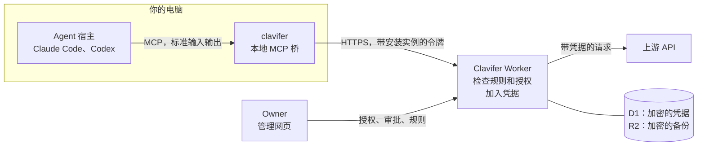

# Clavifer

[English](README.md)

Clavifer 是给 AI agent 用的自托管凭据服务。Agent 通过它调用上游 API，凭据由服务端加进请求，每个 agent 能做什么由唯一的管理员（Owner）在管理网页上决定。

它运行在 Cloudflare Workers 上，用 D1 和 R2 存数据，由三部分组成：Worker、Owner 用的管理网页，以及命令行客户端 `clavifer`。`clavifer` 把 Claude Code、Codex 这类 agent 宿主通过 MCP 接到服务上。

## 工作方式

Agent 手里有 API key，就可能把它带进上下文、日志或文件。Clavifer 不让 agent 接触 key：Owner 把它存成凭据，再定义一个连接，内容是固定的上游地址、凭据加进请求的方式、允许的路径和方法。Agent 只说出连接和路径，不经手 key。



1. Agent 调用 MCP 工具 `http.request`，给出连接、方法和路径。
2. `clavifer` 从操作系统的凭据库取出所属安装实例的访问令牌，带上它转发请求。
3. Worker 检查这个安装实例没有被撤销，再按连接的规则和安装实例的授权判定这个请求。
4. 请求获准时，Worker 解密凭据，把它加进请求，发往连接的地址。Agent 收到上游的响应。
5. 请求未获准时，agent 收到错误码和下一步提示。只要没有命中拒绝规则，agent 就可以提交申请，由 Owner 在网页上批准或拒绝。

另有一种方式给需要凭据原文的程序用：`clavifer run` 启动一个程序，并把凭据字段放进它的环境变量。这需要单独的授权，而且被启动的程序读得到原文。

## 功能

下面列出的都已实现。

- 一个连接包含固定的上游地址、凭据的加入方式（不加、Bearer 令牌、请求头、Basic 认证、查询参数五种之一）、允许的路径和方法，以及三类规则：拒绝、必须单次审批、免审批。
- 每个 agent 客户端是 Owner 创建的一个安装实例。授权按安装实例和资源授予，有期限，可以撤销。读取凭据的授权可以只限其中几个字段。
- Agent 可以提交申请：申请一项授权，申请在连接允许的路径和方法之外临时扩展范围，或者申请对某一个确定的请求做单次审批。单次审批在 10 分钟内有效，只能执行一次。
- Agent 可以提交草案：新建一份凭据和使用它的连接，或者修改一个连接，并附上测试用例。服务端在草案提交时就用真实的判定逻辑跑这些测试。凭据的值由 Owner 在批准时填写。
- 连接可以登记额外域名，或者允许任意地址。把凭据发往这些地址一律要单次审批，批准绑定具体地址。
- MCP 服务有四个工具：`credentials.list`、`access.request`、`access.status`、`http.request`。没有任何工具返回已存的凭据。
- 命令行客户端把登录令牌存在操作系统的凭据库里并自动刷新。多个安装实例用不同名字的 profile 区分。`status --wait` 一直等到 Owner 做出决定，所以 agent 在获批后能自己接着做。`doctor` 检查接入状态，不读取凭据。
- Owner 用密码或 Passkey 登录。新增授权、批准申请、修改连接和备份操作要求最近 10 分钟内登录过。
- 凭据的每个版本用各自的密钥加密，这把密钥再由另一把存放在 Worker secret 里的密钥加密保存。更换凭据的值会生成新版本。
- 自动备份用 age 公钥加密后写入 R2，按天和按月保留。Owner 可以手动导出，也可以恢复到一套空的部署里。
- 每条审计记录都带请求编号，和响应头 `x-request-id` 一致。

## 现状和限制

Clavifer 当前版本是 0.5.0，由作者自己日常使用，没有经过独立的安全审计。

- 只支持部署在 Cloudflare 上。作者只在 Workers Paid 套餐上运行和验证过。Workers Free 套餐每个请求只有 10 ms CPU 时间，对密码哈希和加密很可能不够，这一点没有测试过。
- 只有一个 Owner，没有其他用户和角色，也没有邮件找回。
- 管理网页只有中文界面。英文文档引用界面文字时附英文解释。
- 命令行客户端以 Windows 为先，并在 Windows 上配合 Claude Code 和 Codex 验证过。macOS 和 Linux 能编译，没有在真机上运行过，也没有安装脚本。
- 有的上游会拒绝来自 Cloudflare Workers 的请求，依据是出口地址或 `Cf-Ray` 请求头。这样的上游接不进来，除非自己架设中转。
- 服务把上游的响应原样返回，不检查上游是否回显了凭据，所以只应接入可信的上游。
- 服务端自身的密钥没有轮换流程。

哪些受保护、哪些不受保护，见 [docs/security-model.md](docs/security-model.md)。

## 快速开始

在本地运行需要 Node.js 22.12 或更高版本，不需要 Cloudflare 账户。

```
npm ci
npm run build:web
node scripts/init-secrets.mjs
npm run db:local
npm run dev
```

打开 `http://localhost:8787`，用 `work/local-bootstrap.token` 里的令牌创建 Owner。这个文件请自己打开，不要贴进 agent 对话。[docs/deploy.md 的 Part A](docs/deploy.md#part-a-local-trial) 是同样的步骤，每一步后面带检查方法。

## 部署

部署文档是写给编码 agent 执行的：每一步都写明由 agent 做还是由你做，给出确切的命令和检查结果的方法。Agent 全程不读取服务端密钥，它把密钥生成到文件里，由你转存进密码管理器。

克隆仓库，用你的编码 agent 打开，然后对它说：

> 按照 docs/deploy.md 把这个项目部署到我的 Cloudflare 账户。遇到标着 Human 的步骤就停下来问我。

想手动部署，就自己照着 [docs/deploy.md](docs/deploy.md) 做，标着 Agent 的步骤也由你执行。

## 文档

除本文件外，文档都是英文。

上手：

- [docs/deploy.md](docs/deploy.md)：本地试跑、线上部署、升级、备份和恢复
- [docs/clients.md](docs/clients.md)：接入 Claude Code 或 Codex，以及命令行客户端的用法

概念和参考：

- [docs/connections.md](docs/connections.md)：连接、规则、授权和申请
- [docs/authentication.md](docs/authentication.md)：Owner 登录，以及客户端的 OAuth
- [docs/security-model.md](docs/security-model.md)：服务保护什么，边界在哪里
- [docs/api.md](docs/api.md)：HTTP 接口

项目：

- [SECURITY.md](SECURITY.md)：报告安全漏洞
- [CONTRIBUTING.md](CONTRIBUTING.md)：开发环境和检查项
- [CHANGELOG.md](CHANGELOG.md)：各版本的改动

## 许可证

[Apache-2.0](LICENSE)。版权所有 2026 Oganneson，见 [NOTICE](NOTICE)。
