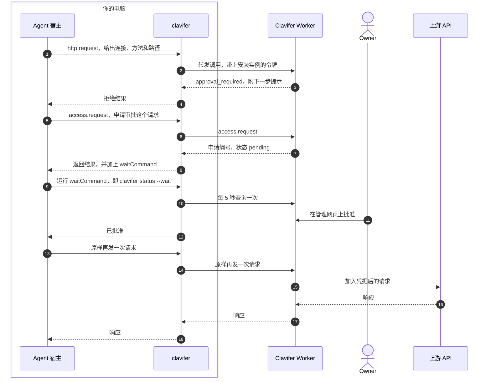

<p align="center"><picture>
  <source media="(prefers-color-scheme: dark)" srcset="docs/assets/logo-dark.svg">
  
</picture></p>

<p align="center"><strong>AI agent 通过 Clavifer 调用 API，凭据始终留在服务端。</strong></p>

<p align="center">
  <a href="#文档">文档</a> · <a href="docs/deploy.md">部署</a> · <a href="docs/clients.md">接入 agent</a> · <a href="docs/security-model.md">安全模型</a> · <a href="README.md">English</a><br>
  <a href="https://github.com/Ogannesson/clavifer/actions/workflows/ci.yml"></a>
  <a href="LICENSE"></a>
</p>

Clavifer 是一个自托管的凭据服务。如果你让 AI agent 调用需要密钥的 API，可以用它把密钥挡在 agent 之外：agent 把请求发给 Clavifer，凭据由服务端加进请求，agent 自己始终拿不到。每个 agent 能做什么，由唯一的管理员（Owner）在管理网页上决定。Clavifer 部署在你自己的 Cloudflare 账户里，用 Workers、D1 和 R2。它的命令行客户端 `clavifer` 把 agent 宿主（运行 agent 的程序，例如 Claude Code、Codex）通过 MCP 接入服务。

请求需要 Owner 审批时，agent 看到的过程如下（示意，ID、提示文字和字段有删节）：

```text
> http.request    POST /v1/payments/1 on connection CONNECTION_ID
< error           approval_required: "needs a one-time Owner approval … call access.request"
> access.request  the same request, reason "Pay invoice 1"
< result          {"id":"REQUEST_ID","status":"pending","waitCommand":"clavifer status REQUEST_ID --wait"}
$ clavifer status REQUEST_ID --wait        # returns once the Owner decides
{"id":"REQUEST_ID","status":"approved",…}
> http.request    POST /v1/payments/1 on connection CONNECTION_ID
< result          {"status":200,…}
```

> [!WARNING]
> Clavifer 0.5.0 是它的第一个公开版本。项目由一个人维护，作者自己日常在用，没有经过独立的安全审计。1.0 之前的版本可能有不兼容的改动；升级到某个版本需要额外操作时，[CHANGELOG.md](CHANGELOG.md) 会在该版本下写明。

## 工作方式

Agent 手里有 API 密钥，就可能把它带进上下文、日志或文件。用 Clavifer 时，Owner 把密钥存为一份凭据，再为它定义一个连接：固定的上游地址、凭据加进请求的方式、允许的路径和方法。每个 agent 宿主在服务上登记为一个[安装实例](docs/authentication.md#installations)（installation），由 Owner 创建并授权。Agent 只需指明用哪个连接、访问哪个路径。请求超出所属安装实例的权限时，agent 向 Owner 申请，获批后再把请求发一次：



- 第 1、2 条：`clavifer` 由 agent 宿主作为本地 MCP 服务启动，它从操作系统的凭据库取出所属安装实例的访问令牌，带上令牌转发。Worker 先确认这个安装实例没有被撤销，再按连接的规则和安装实例的授权判定请求。
- 第 3、4 条：拒绝结果带有错误码和下一步提示。命中拒绝规则就到此为止。因为超出连接允许的路径和方法、命中审批规则或缺少授权而被拒的请求，可以转成申请，由 Owner 在网页上批准或拒绝。
- 第 15 条：请求获准，Worker 解密凭据，把它加进请求，发往连接的地址。

MCP 服务有四个工具：`credentials.list`、`access.request`、`access.status`、`http.request`，没有一个会返回已存的凭据。

`clavifer run` 是唯一的例外：它启动一个程序，把凭据字段放进程序的环境变量，所以这个程序拿到的是凭据明文。这需要单独的读取授权。

## Owner 能控制什么

- **连接。** 一个[连接](docs/connections.md#what-a-connection-holds)包含固定的 HTTPS 上游地址、凭据的加入方式（不加、Bearer 令牌、请求头、Basic 认证、查询参数五种之一）、允许的路径和方法，以及三类规则：拒绝、必须审批、免审批。命中免审批规则的请求不需要任何授权就能通过。
- **授权。** 一项[授权](docs/connections.md#grants)授予一个安装实例，对象是一个连接或一份凭据。有效期由 Owner 选定，也可以不设期限、一直有效到撤销；撤销从下一个请求起生效。读取凭据的授权可以只限其中几个字段。
- **申请。** Agent 可以提交[申请](docs/connections.md#access-requests)：申请一项授权，申请在连接允许的路径和方法之外临时扩展范围，或者申请对某一个确定的请求做单次审批。单次审批在 10 分钟内有效，只能执行一次。
- **草案。** Agent 可以提交[草案](docs/connections.md#drafts)：新建一份凭据和使用它的连接，或者修改一个连接，并附上测试用例。服务端在草案提交时就用真实的判定逻辑跑这些测试。凭据的值由 Owner 在批准时填写。
- **其他地址。** 有的 API 会把请求引到另一个域名，例如下载用的域名。为此，连接可以登记[额外域名，或者允许任意地址](docs/connections.md#requests-to-another-origin)。凭据只会随 Owner 逐个批准过的请求（单次审批）发往这些地址，每次批准只对那一个地址有效。
- **近期登录。** Owner 用密码或 Passkey 登录。敏感操作，例如新增授权、批准申请、新建或修改连接、下载完整导出、更换备份接收者，都[要求最近 10 分钟内登录过](docs/authentication.md#operations-that-need-a-recent-sign-in)。
- **加密、备份和审计。** [凭据的值在写入数据库之前就已加密](docs/security-model.md#how-secrets-are-stored)，所用的密钥由服务唯一的 Worker secret（根密钥）派生而来。[备份](docs/security-model.md#backups)是整个实例的快照，用 age 公钥加密：服务自动写入 R2，Owner 也可以下载完整导出；两者都能导入一套新实例，用于迁移，或者在根密钥丢失后恢复。每条[审计记录](docs/security-model.md#audit-log)都带请求编号，和响应头 `x-request-id` 一致；旧记录会移进加密的归档文件，不会删除。

## 上手

除本文件外，文档都是英文。

| 目的              | 需要                                                                                                |
| ----------------- | --------------------------------------------------------------------------------------------------- |
| 本地试用          | Node.js 22.12 或更高版本、git                                                                       |
| 部署到 Cloudflare | 以上各项、Cloudflare 账户（在 Workers Paid 套餐上验证过）、同一账户里由 Cloudflare 托管 DNS 的域名、已开通的 R2 |
| 接入 agent 宿主   | 用来编译 `clavifer` 的 Go、Claude Code 或 Codex，Windows 上还需要 PowerShell 7（只在 Windows 上验证过） |

想在本地试用，按 [docs/deploy.md 的 Part A](docs/deploy.md#part-a-local-trial) 操作，完成后会得到一套运行中的服务和它的管理网页。想看到 agent 真正用上它，还要接入一个 agent 宿主，并在管理网页上建好第一个连接。

想部署到 Cloudflare，按 [docs/deploy.md](docs/deploy.md) 操作。这份文档是写给编码 agent 执行的：每一步都写明由 agent 做还是由你做，给出命令和检查结果的方法。服务端密钥全程不经过 agent。想手动部署，标给 agent 的步骤也由你自己执行；否则克隆仓库，用你的编码 agent 打开，然后对它说：

> 按照 docs/deploy.md 把这个项目部署到我的 Cloudflare 账户。遇到标着 Human 的步骤就停下来问我。

想把 Claude Code 或 Codex 接到一套已经在运行的服务上，按 [docs/clients.md](docs/clients.md) 操作，它同样逐步写明由谁执行、如何验证。

## 给 AI agent

- 要部署 Clavifer：按顺序执行 [docs/deploy.md](docs/deploy.md)，遇到标着 Human 的步骤就停下。
- 要使用一套部署：读 MCP 服务在宿主连接时返回的说明，以及 [integrations/skills/clavifer/SKILL.md](integrations/skills/clavifer/SKILL.md)。
- 要修改代码：读 [AGENTS.md](AGENTS.md)。

无论哪种情况，密钥的值都不经过你。脚本会把密钥写进文件，不要打开、打印、复制或概括这些文件。凭据由用户在管理网页上填写，不要放进对话。

## 现状和限制

- 只支持部署在 Cloudflare 上，需要 Workers Paid 套餐，并在这个套餐上运行和验证过。Workers Free 套餐用不了：封存旧记录、备份、导出和导入在一次调用里最多要用 30 秒 CPU 时间和 1000 次数据库查询，而 Free 套餐只给 10 ms 和 50 次。
- 只有一个 Owner，没有其他用户和角色，也没有邮件找回。
- 管理网页只有中文界面。英文文档引用界面文字时附英文解释。
- 命令行客户端以 Windows 为先，在 Windows 上配合 Claude Code 和 Codex 验证过。macOS 和 Linux 能编译，但没有在真机上运行过，也没有安装脚本。
- 有两类上游没法直接接入：一是拒绝来自 Cloudflare Workers 的请求的上游；二是需要的不只是固定凭据的上游，例如要求请求签名或客户端证书。详见 [docs/connections.md](docs/connections.md#upstreams-that-cannot-be-connected)。
- 服务把上游的响应原样返回，不检查上游是否回显了凭据，所以只应接入可信的上游。
- 服务端的根密钥没有轮换流程，也不存在任何副本。根密钥丢失时，要用最近一次自动备份重建实例，这次备份之后的改动会丢失。
- Clavifer 限制 agent 能碰到什么，但不判断意图。在授权范围内，agent 可以发出任何没有命中拒绝规则或审批规则的请求。

哪些受保护、哪些不受保护，见 [docs/security-model.md](docs/security-model.md)。

## 和同类项目的比较

据 Infisical 自己的 README，它的 Agent Vault 采用类似的机制，agent 的请求经过一个代理，由代理加上真实凭据；Clavifer 则是一个独立的服务，只有一个 Owner，部署在这个 Owner 自己的 Cloudflare 账户里。

## 文档

上手：
- [docs/deploy.md](docs/deploy.md)：本地试用、部署到 Cloudflare、升级、备份、迁移和恢复
- [docs/clients.md](docs/clients.md)：接入 Claude Code 或 Codex，以及命令行客户端的用法

概念和参考：
- [docs/connections.md](docs/connections.md)：连接、规则、授权和申请
- [docs/authentication.md](docs/authentication.md)：Owner 登录，以及客户端的 OAuth
- [docs/security-model.md](docs/security-model.md)：服务保护什么，边界在哪里
- [docs/api.md](docs/api.md)：HTTP 接口和 MCP 工具

项目：
- [AGENTS.md](AGENTS.md)：给在本仓库里改代码的编码 agent 看的说明
- [CONTRIBUTING.md](CONTRIBUTING.md)：开发环境和检查项
- [SECURITY.md](SECURITY.md)：报告安全漏洞
- [CHANGELOG.md](CHANGELOG.md)：各版本的改动

## 许可证

[Apache-2.0](LICENSE)。版权所有 2026 Oganneson，见 [NOTICE](NOTICE)。
